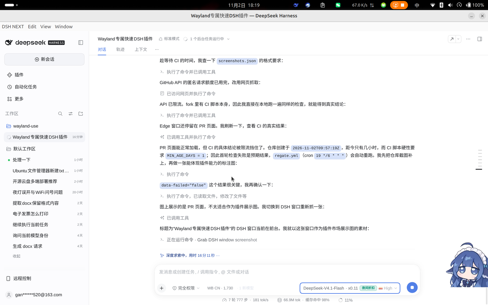
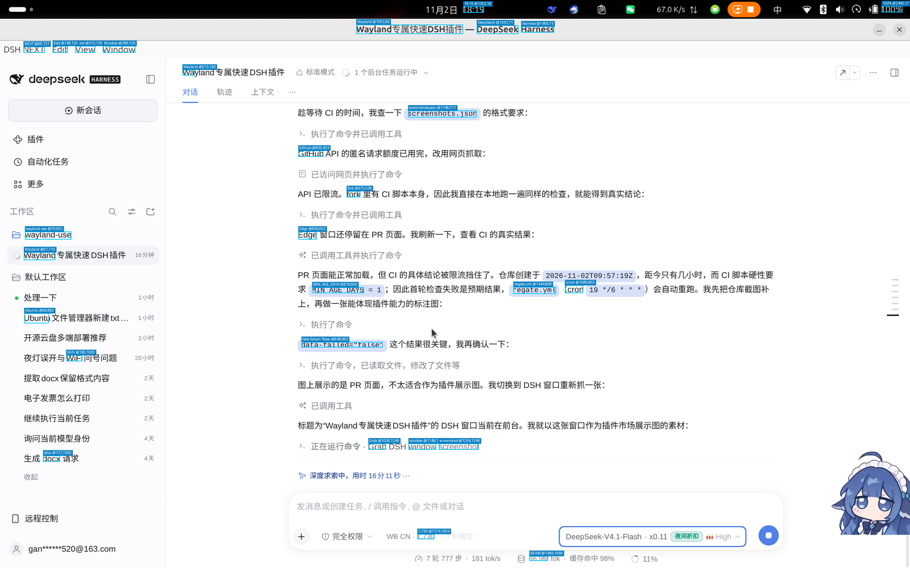

# dsh-wayland-use

给 DeepSeek Harness 用的 **Wayland 原生桌面控制插件**。不走 xdotool / uinput / X11，
直接用 Mutter 的 `RemoteDesktop` + `ScreenCast` 两个 D-Bus 会话读写桌面，所以点击、
按键、截图在纯 Wayland 会话下是真的生效，而不是只动 XWayland 的光标。

## 为什么它比 cua-driver-native 快

关键差别是**常驻**：后端是一个 Python 进程，Mutter 会话和 GStreamer 管道从头到尾
只建一次（约 300ms），之后每一步都在毫秒级。

| 操作 | 耗时 |
| --- | --- |
| `wayland_status` | 0.1ms |
| `wayland_screenshot`（首次，含建会话） | ~230ms |
| `wayland_screenshot`（之后，取缓存帧） | **2ms** |
| 操作后截图（等到新帧） | ~47ms |
| `wayland_key` | 1–2ms |
| `wayland_click_text`（含 OCR） | ~170–190ms |
| `wayland_act` 批量 3 步 + 截图 | ~600ms |

截图之所以能到 2ms：PipeWire 是**画面变化驱动**的，静止时不出帧，所以缓存帧就是
当前画面；插件给每次输入动作打时间戳，帧比动作新就直接回缓存，不用重抓。

## 截图





下面这张是 `wayland_read` 的产物：图上每个框都是 OCR 认出的文字，框左上角的
`文字 @x,y` 就是可以直接喂给 `wayland_act` 的 `click` 的逻辑坐标。

## 安装

```sh
dsh plugin add https://github.com/<owner>/dsh-wayland-use
```

或手动装进 profile（`~/.dsh/profiles/<profile>/`）三处：

1. 把本包放进 `node_modules/dsh-wayland-use`（或做成符号链接，改源码立即生效）
2. `package.json` 的 `dependencies` 加 `"dsh-wayland-use"`，`dsh.profile.bundles` 也加一条
3. `cordis.patch.yml` 加 `- id: wayland-use` + `name: dsh-wayland-use`

DSH 的 HMR 会自动热载新的 patch，不用重启。**唯一的例外**：`lib/daemon.py` 是子进程，
改完要 `pkill -f "daemon[.]py"`，下次调用时它会自己重新拉起。

## 工具

| 工具 | 作用 |
| --- | --- |
| `wayland_screenshot` | 截图。`region` 局部、`scale` 缩放、`maxWidth` 限宽 |
| `wayland_read` | OCR 读出屏幕上的文字**带坐标**，`contains` 过滤 |
| `wayland_windows` | 列窗口标题 + 矩形 + 焦点标记（AT-SPI） |
| `wayland_act` | **主力**：一次调用跑一串动作，只回一张最终截图 |
| `wayland_click_text` | 按文字找并点击（不用自己猜坐标） |
| `wayland_key` | 按组合键，如 `ctrl+a`、`super+Return` |
| `wayland_launch` | 启动程序 |
| `wayland_status` | 自检；`reset: true` 重建会话 |

`wayland_act` 的 step 支持：`click` `clickText` `type` `key` `move` `scroll`
`wait` `waitText` `launch` `sleep`，每步可带 `settleMs`。能用批量就别逐步来 ——
一次往返比十次往返快得多，这也是「笨」和「快」的真正差距。

## 坐标

对外一律是**逻辑像素**（本机 1536×960；你的机器按实际缩放），内部乘 scale 换成物理像素
给 Mutter。OCR 出来的坐标和 `wayland_windows` 的矩形都是同一套，可以直接互相喂。

## 几个坑（都踩过，别再踩）

- **不要用 `NotifyKeyboardKeysym` 打文本**。有 ibus/拼音输入法的机器上字母键会被
  输入法吃掉（打 `abc` 得到 `阿保持`）。文本一律走 `NotifyKeyboardKeycode` 敲 Ctrl+V，
  内容经 RemoteDesktop 自带的剪贴板送进去。
- **`SelectionWrite` 是带 out-fd 的方法**，必须用 `bus.call_with_unix_fd_list_sync`
  拿 `fdl.get(0)`；用普通 `call_sync` 拿到的 fd 数值是坏的（`[Errno 9] Bad fd`）。
- **剪贴板请求要一直服务**。GTK 是在按下 Ctrl+V 的那一刻才来要数据的，只服务第一次
  会粘不上。
- **键码是裸 evdev**（`NotifyKeyboardKeycode(30)` = A），不是「evdev+8」。
- **两个会话的启动顺序是硬约束**：建 RD → 读 SessionId → 建 SC 并带上
  `remote-desktop-session-id` → RecordMonitor → **只 Start RD**。手动 Start SC 会报
  `Must be started from remote desktop session`。
- **绝对指针定位要联动 screencast 会话**才能用 `NotifyPointerMotionAbsolute`，
  它收的是物理像素。
- **OCR 不能一刀切放大**。稀疏画面 2 倍反而吐不出东西（`--psm 3` 返回空），密集桌面
  2 倍才好。所以是「1 倍找不到才升级到 2 倍」。
- **OCR 不要用 `chi_sim+eng` 混合模型**，它会把整行拉丁字母丢掉。要并行跑 `eng` 和
  `chi_sim` 两份再合并，代价等于最慢那条（并行），却能同时拿到中英文。

## 环境变量

| 变量 | 默认 | 说明 |
| --- | --- | --- |
| `DSH_WAYLAND_PYTHON` | `/usr/bin/python3` | 需要带 `gi` |
| `DSH_WAYLAND_JPEG_QUALITY` | `75` | 截图质量 |
| `DSH_WAYLAND_OCR_LANGS` | `eng,chi_sim` | 并行通道 |
| `DSH_WAYLAND_OCR_BANDS` | `8` | OCR 横切条数 |
| `DSH_WAYLAND_OCR_UPSCALE` | `1` | 默认放大倍数（找不到会自动升到 2） |

后端的 stderr 里带 ERROR/Traceback 的行会写到 `$TMPDIR/dsh-wayland-<uid>/daemon.log`。

## 依赖

系统：`python3-gi`（Gio/GLib/Gst/PIL）、`gstreamer1.0-plugins-{base,good}`（pipewiresrc /
videoconvert / jpegenc）、`tesseract-ocr` + `tesseract-ocr-chi-sim`（OCR，可选）。
无 Node 侧依赖。
